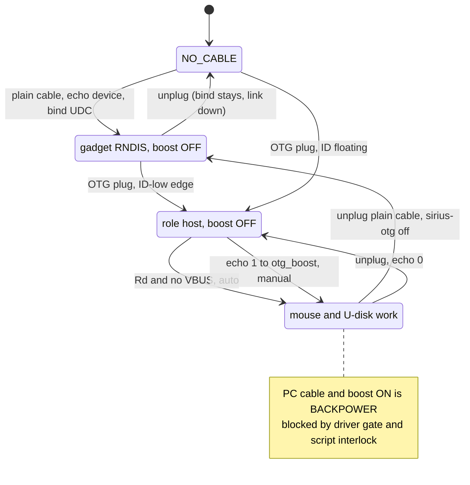

# sirius USB host / 自供电修复手册

> 2026-09-26 定稿，手机实测通过。对应上游 `57UU/linux-sirius`
> `feat/sirius-7.2 @ 3606aa01`，boot 镜像
> `boot_sys-72-otg-20260926.img`（`E:\Tools\Device\8se\linux\boot-images\`）。
>
> **2026-10-19 更新**：角色判断已由内核 Type-C 栈（TCPM + PM660 CC 状态机）
> 接管，本文描述的「用户态角色跟随」（`sirius-usb-bind` + `99-sirius-usb.rules`
> + `sirius-otg` 的 manual pin）**已从仓库和设备上删除**。现行方案见
> [`USB-TYPEC.md`](USB-TYPEC.md)。
> 本文仍然有效的内容：§2 `dr_mode="otg"`、§3 OTG 自供电原理、§9 Windows
> RNDIS 的 VID/PID 坑，以及 §7 里「别热替换 charger 驱动」的教训；
> §5/§6/§8 仅作历史记录。

## 1. 背景：之前为什么只能当网卡

- `initramfs` 写死 `configfs g1 + rndis.usb0`，`rootfs` 静态 `usb0 172.16.42.1`。
- 更深一层：`usb_1_dwc3` 的 `dr_mode = "peripheral"` 把角色锁死，
  `echo host > /sys/kernel/debug/usb/a600000.usb/mode` 返回成功但读回
  仍是 `device`，dmesg 无任何动静。此时 `extcon` 已报 `USB-HOST=1`，
  说明线缆检测到了，是控制器拒绝切换。
- pmOS 对同类硬件的描述同样适用：`auto` 会来回抖动，只能手动切；
  PMIC 缺供电逻辑，直插无源设备无电；只测 USB2 速率。

## 2. 修复一：解锁角色（已合入主线）

`arch/arm64/boot/dts/qcom/sdm710-xiaomi-sirius.dts`：

```diff
 &usb_1_dwc3 {
-	dr_mode = "peripheral";
+	dr_mode = "otg";
```

补丁已合入上游 `feat/sirius-7.2 @ 3606aa01`（见 `kernel/linux-sirius` submodule）。
当时为避免重编整个内核，用的是 dtb 热补丁流程（server2 有
`dtc/mkbootimg/unpack_bootimg`）：由在用的
`boot_sys-72-nodebug-20260924.img` 解出 `Image.gz + dtb`，
只改 dtb 后原样回编，`Image.gz`/`initramfs`/`cmdline` 保持不变。

改后行为：开机会跟 extcon 走（目前基本是 host，gadget 需手动绑回）；
`mode` 文件读写正常，`UDC` 解绑/重绑正常。

## 3. 修复二：自供电（驱动已转正，见上游 commit）

- 根因：`qcom_smbx`（pm660-charger）把 OTG 配成软件控制后，
  运行时从不真正打开 boost（全文件唯一的 OTG 写操作在 init 表里）。
  下游 smb5 的等效操作是 `smblib_vbus_regulator_enable`：
  `DCDC_CMD_OTG_REG(0x1140) |= BIT(0)`。
- 交付（已转正）：`qcom_smbx` 驱动上游已合入，供电走 `otg_boost` 属性；
  现在由 TCPM 的 `set_vbus()` 在切到 source 角色时自动打开，用户态不用管。
  `src/sirius-otg-boost/` 测试模块退役（kmod 包里的旧二进制下次刷新时删掉）。
- 验证（历史）：`sirius-otg on`（dmesg 显示 `before=0x0 after=0x1`）→ 鼠标灯亮并枚举为
  `USB OPTICAL MOUSE`（`hid-generic`，`REL_X/REL_Y + 左中右键`）；
  `rmmod` → 灯灭掉线。开关系双向验证通过。
- 编译要求模块 vermagic 与手机内核严格一致
  （`7.2.3-sdm670-gcbbdbeb2ca53`，注意 `LOCALVERSION` 环境变量留空
  否则多一个 `+` 后缀导致 `insmod` 拒绝），用 `~/kbuild/linux-sirius`
  按本库 defconfig `modules_prepare` 后编译，见模块目录 README。
- 鼠标可直插使用（PMI660 boost 带得动）；U 盘待测。

## 4. 查看状态（WiFi SSH 下执行）

现在不需要手动切角色了，`sirius-otg` 只剩只读诊断：

```bash
sudo sirius-otg status   # 角色归属、power/data role、partner、boost、usb0
sudo sirius-otg watch 1  # 每秒刷新
```

`on/off/auto` 已删除（会提示角色由线缆决定）。真要调试角色，直接写 dwc3
的角色开关，TCPM 在下一次插拔时会重新接管：

```bash
echo host   | sudo tee /sys/class/usb_role/a600000.usb-role-switch/role
echo device | sudo tee /sys/class/usb_role/a600000.usb-role-switch/role
```

（没有 Type-C 栈时，旧路径是 `echo host > /sys/kernel/debug/usb/a600000.usb/mode`，
再配合 `otg_boost` 属性开关供电；现在只作应急。）

不要往内核 `mode` 文件里写 `auto`（没有 CC 栈时会在 host/device 间来回抖）。
现在角色由 TCPM 自动管，上面这些裸命令只在 `qcom_smb2_tcpm` 没加载时才有意义。

## 5. 角色跟随（已删除，2026-10-19）

这一节描述的是用户态伪 auto：`sirius-usb-bind` 按三路 udev 事件
（pm660-charger power_supply + usb_device 插拔 + qcom_smbx 的
platform/OTG_CABLE）摆角色，回 device 前先关 boost 防 backpower，再绑回
UDC；`sirius-otg on/off` 用 `/run/sirius-usb-manual` 钉住手动状态。

内核 Type-C 栈（`qcom_smb2_tcpm` + TCPM）上线后，这套东西变成纯负担：
它和 TCPM 抢同一个角色、同一条 boost 位。所以 2026-10-19 一并删掉：

- `usr/local/sbin/sirius-usb-bind`
- `etc/systemd/system/sirius-usb-bind.service`
- `etc/udev/rules.d/99-sirius-usb.rules`
- `sirius-otg` 里的 manual pin / `on` / `off` / `auto` 分支（脚本只剩 status/watch）

角色现在只由 CC 线决定，`sirius-otg` 变成了只读的诊断命令
（角色要强制就写 `usb_role/.../role`，纯内核调试）。

历史记录：实测 extcon 真实拔插不发 uevent（gpio38 中断没动静），所以旧方案
里 extcon 规则一直是死的；UDC 绑定是软件状态，拔线不掉绑，只有角色翻转才踢。

## 6. 局限（历史）

ID 是 Micro-USB 时代遗留的 OTG 识别针（接地 host / 悬空 device），CC 才是
Type-C 的完整协商输入。旧方案拿不到 CC 的完整状态，只能拼 ID + 「PMIC 看到
Rd」两个单边信号，于是有「部分线要翻面」「ID 接地的线钉死 host」「切了角色
还要手动开供电」这些毛病——这些都被内核 CC 栈取代了。

物理限制仍然存在：本机只有 USB2（无 SS 差分对）、没有 SBU/DP 通路。

## 7. 代办 / 注意事项

- ~~CC 完整栈~~：2026-10-18 落地（`docs/USB-TYPEC.md`），2026-10-19 删掉
  用户态跟随；`extcon` 节点保留但不再参与角色判断。
- **别热替换 charger 驱动**：rmmod qcom_smbx 会在注销电源供应时吃 WARN
  （fg 还拿着引用），并可能在通知链里留坏表项，之后每次电源状态变化都 oops
  掉一个 kworker，第二次 rmmod 直接 D 住卸不掉，只能重启；测驱动改动请走
  重启（新模块已进 lib/modules，重启即生效）。


## 8. 状态机



## 9. Windows 认不到 RNDIS：gadget VID:PID 被 Google 驱动劫持
（2026-10-13，手机实测定位）

现象：手机侧 gadget 正常（单 RNDIS 功能、UDC 已绑、usb0 UP 有 IP），
Windows 上却只有一个 OK 的 Android ADB Interface，没有 RNDIS 网卡，
`172.16.42.1` 不通。重绑 UDC、换线无效。

根因：gadget 沿用 pmOS initrd 默认 `18D1:D001`，而这台 Windows 装有
Google USB 驱动（fastboot/adb 需要，oem31.inf v9.0.0.0），其中有
`USB\VID_18D1&PID_D001` 的精确匹配。Windows 驱动排序里 HWID 精确匹配
优先于 inbox RNDIS 的 compatible-ID 匹配，于是整个设备被绑成 ADB 口，
RNDIS 功能永远拿不到驱动。`MatchingDeviceId` 实测即此条，可复现。

修复：gadget 改用无人认领的经典 Linux RNDIS ID `0525:A4A2`
（`boot/initrd/initramfs/init_functions.sh` 里 `setup_usb_network`
的默认值，照抄注释）。bootloader 的 fastboot（`18D1:D00D`）不受影响；
udev/脚本里只认 UDC 路径和 usb0 接口名，无一处依赖旧 VID:PID。
改后 Windows 直接上 inbox Remote NDIS 驱动，DHCP 拿到 `172.16.42.2`，
USB ssh 恢复。此前 USB ssh 时好时坏，即为驱动排序抖动所致。
